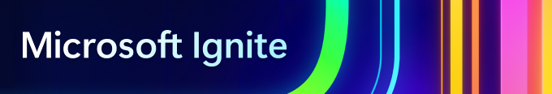

<a name="start-building"></a>

<p align="center">

</p>

# [Microsoft Ignite 2026](https://ignite.microsoft.com)

## 🔥LAB730: Build Healthcare Agents with Foundation and Reasoning Models
### Session description

Learn how to combine healthcare foundation models in Microsoft Foundry with Microsoft AI reasoning models to build intelligent healthcare agents that can analyze, orchestrate, and act on multimodal healthcare data. Explore how they can synthesize information across systems, coordinate workflows, and support clinical, operational, and research scenarios. Discover how agents can deliver context-aware insights that can help healthcare professionals make more informed decisions.

**Lab code:** The starter files, answer keys, sample brain MRI scans, and chapter guides are in [microsoft/LAB730-ignite-2026-healthcare-agents](https://github.com/microsoft/LAB730-ignite-2026-healthcare-agents).

> [!IMPORTANT]
> **This lab depends on a custom model.** It calls a MedImageParse 3D model that we fine-tuned to segment brain tumors on post-contrast T1 MRI, using data from [UPENN-GBM](https://www.cancerimagingarchive.net/collection/upenn-gbm/). During the lab at Ignite 2026, we provided access to this model. The lab does not work without this custom model. To run the lab, you can:
>
> - **Fine-tune your own.** Follow the [MedImageParse 3D fine-tuning example](https://github.com/microsoft/healthcareai-examples/tree/main/azureml/medimageparse3d/finetuning) to fine-tune, evaluate, and deploy the model with Azure Machine Learning. Use UPENN-GBM as we did, or a different dataset.
> - **Ask us for access.** Contact [hlsfrontierteam@microsoft.com](mailto:hlsfrontierteam@microsoft.com), and we can provide access to the model.
>
> The [lab code README](https://github.com/microsoft/LAB730-ignite-2026-healthcare-agents#readme) explains how to connect the lab to your endpoint.

### 🚀 Getting started

#### In a guided session

If you're following along during a live session:

1. Sign in to the lab virtual machine. The tools are installed, and the lab code is in `C:\Lab`.
2. Follow the lab instructions in the lab environment. The same pages are in [`instructions/`](instructions/README.md).

#### On your own

If you're learning at your own pace:

1. Clone [microsoft/LAB730-ignite-2026-healthcare-agents](https://github.com/microsoft/LAB730-ignite-2026-healthcare-agents).
2. Install the prerequisites listed in its README: VS Code with GitHub Copilot, Git with Git LFS, and uv.
3. Work through the three chapters in its `chapters/` folder. Chapters 2 and 3 need MedImageParse endpoint credentials in a `.env` file, as its README describes.

### 🎯 Learning outcomes

By the end of this session, you will be able to:

- Build a custom agent in VS Code with GitHub Copilot, and give it a reusable skill that produces structured radiology reports.
- Connect a healthcare foundation model, MedImageParse 3D, to the agent through a Model Context Protocol (MCP) server, and turn its segmentation masks into measurements with code.
- Ground the agent's reports in patient history and prior reports, so it interprets change between exams correctly.

### 💻 Technologies used

- [MedImageParse 3D](https://learn.microsoft.com/azure/foundry-classic/how-to/healthcare-ai/deploy-medimageparse)
- [Healthcare AI models in Microsoft Foundry](https://learn.microsoft.com/azure/foundry/how-to/healthcare-ai/healthcare-ai-models)
- [GitHub Copilot in VS Code](https://code.visualstudio.com/docs/agents/overview)
- [Custom agents](https://code.visualstudio.com/docs/agent-customization/custom-agents) and [Agent Skills](https://code.visualstudio.com/docs/agent-customization/agent-skills) in VS Code
- [MCP servers in VS Code](https://code.visualstudio.com/docs/agent-customization/mcp-servers)

### 📚 Continue your learning

Pick your next step based on your learning style:

| Resource | What you'll get |
|----------|-----------------|
| **[Ignite 2026 Next Steps](https://aka.ms/ignite26-next-steps)** | Additional session repos and materials from Microsoft Ignite 2026 |
| **[Microsoft AI Skills Navigator](https://aka.ms/ignite26-asn)** | Discover AI skills, learning paths, and resources for your next step |
| **[Microsoft Learn](https://aka.ms/ignite26-learn)** | Official documentation and guided learning paths on these topics |
| **[Microsoft Foundry Community](https://aka.ms/MicrosoftFoundryDiscord-Ignite26)** | Connect with other learners and experts in our Discord community |

### 🌟 Microsoft Learn MCP Server

The Microsoft Learn MCP Server gives your AI agent direct access to Microsoft's official documentation — grounded, up-to-date answers about the topics in this session.

**GitHub Copilot CLI** — Install with:

```shell
copilot plugin install microsoftdocs/mcp
```

**VS Code** — One-click install:  
[](https://vscode.dev/redirect/mcp/install?name=microsoft-learn&config=%7B%22type%22%3A%22http%22%2C%22url%22%3A%22https%3A%2F%2Flearn.microsoft.com%2Fapi%2Fmcp%22%7D)

For more information, visit the [Learn MCP Server repo](https://aka.ms/learnmcp).

### 👥 Content owners

<table>
<tr>
    <td align="center"><a href="https://github.com/jmerkow">
        <br />
        <sub><b>Jameson Merkow</b></sub></a><br />
            <a href="https://github.com/jmerkow" title="talk">📢</a>
    </td>
    <td align="center"><a href="https://github.com/ivantarapov">
        <br />
        <sub><b>Ivan Tarapov</b></sub></a><br />
            <a href="https://github.com/ivantarapov" title="talk">📢</a>
    </td>
</tr></table>

### ⚖️ Trademarks

This project may contain trademarks or logos for projects, products, or services. Authorized use of Microsoft trademarks or logos is subject to and must follow [Microsoft's Trademark & Brand Guidelines](https://www.microsoft.com/legal/intellectualproperty/trademarks/usage/general). Use of Microsoft trademarks or logos in modified versions of this project must not cause confusion or imply Microsoft sponsorship.

Any use of third-party trademarks or logos are subject to those third-party's policies.
